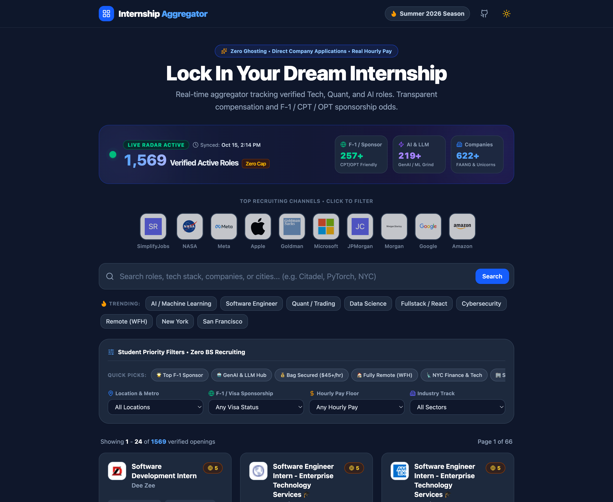

# 🎓 实习信息聚合器 (Internship Aggregator)

[](https://reactjs.org/)
[](https://fastapi.tiangolo.com/)
[](https://www.sqlite.org/)
[](https://tailwindcss.com/)
[-100%25%20达标-10B981)](./backend/data_quality_audit.json)
[](https://internship-aggregator-nu.vercel.app/)

[English](./README.md) | [简体中文] | 🌐 **在线演示**: [internship-aggregator-nu.vercel.app](https://internship-aggregator-nu.vercel.app/)

一个面向北美高校学生的**可审计、证据驱动型全栈实习信息聚合平台**。深度整合企业官方招聘 API、公开 ATS 接口（Workday、SmartRecruiters、Greenhouse & Lever）、官方招聘门户与社区核验数据源，实时追踪 **654 家企业**的 **2,542 条真实有效实习岗位**——**零模拟数据、零占位薪酬、零虚构技能要求，所有薪资、技能与签证判断均保存雇主原文证据链**。



---

## 🛡️ 数据真实性与“零虚构”可审计架构

区别于市面上常见的用占位薪资、猜测技能或主观概率（如“签证友好度 8/10”）填充列表的聚合工具，本项目在 [`backend/data_quality.py`](backend/data_quality.py) 中实施严格的**数据真实性与原文证据准入机制**：

1. **彻底隔离模拟数据与禁止占位字段**
   - 永久禁用任何模拟生成源（`BLOCKED_SOURCE_TYPES`），所有入库记录必须具备真实上游来源（`source`、`source_type`、`sources_list`）。
   - 严禁注入 `"$30 - $60 / hr"` 等占位薪资或 `"Python, React, SQL"` 等模板技能；无招聘原文证据支撑时一律保持 `null`，绝不把推断结果包装成已核验事实。
2. **独立岗位详情 URL 强校验（拒绝通用搜索页）**
   - 每条记录必须指向**包含独立 Job ID 或专属详情路径的申请链接**（`is_dedicated_job_detail_url()`）。
   - 严禁将企业 `/search`、`/jobs`、`/careers` 等通用搜索列表页当成岗位申请链接；无法取得独立详情链接的记录将被标记为 `pending_review` 或直接拒绝进入正式岗位库。
3. **三类生命周期时间戳严格分离**
   - `posted_at`：**招聘方提供的真实发布日期**（如 Greenhouse `updated_at`、Lever `createdAt`、Microsoft `postedDate`）；若上游来源未提供真实雇主发布日期，则严格保持 `null`。
   - `first_seen_at`：系统首次发现该岗位的时间。
   - `last_verified_at`：系统最近一次核验确认该岗位仍然有效的时间。
4. **明确的 `job_type` 岗位类型验证**
   - 每个岗位均通过 `classify_job_type()` 明确划分为 `internship`、`co-op`、`fellowship`、`new_grad_full_time`、`other_student_program` 或 `non_student`。
   - 自动拦截并隔离混入的非学生社招全职岗位及应届全职（New Grad FT）岗位，**只有通过目标实习类型验证的记录（`internship`、`co-op`、`fellowship`）才能进入默认实习列表**。
5. **可审计的工作授权/签证分类（`visa_status` + 原文证据）**
   - 废除无数据支撑的“签证友好度 8/10”概率化暗示（`international_score = null`），改为四类可审计状态，并同步保存原文证据 `visa_evidence`、来源 `visa_source_url` 和核验时间 `visa_verified_at`：
     | 字段状态 (`visa_status`) | 含义 |
     | :--- | :--- |
     | `sponsorship_explicitly_supported` | 当前岗位原文明确说明提供签证担保或接受 F-1 / CPT / OPT 等工作授权 |
     | `explicitly_restricted` | 招聘原文明确要求美国公民身份 / 安全审查 / ITAR 或明确排除签证担保 |
     | `not_specified` | 当前岗位原文未明确说明签证或工作授权限制 |
     | `needs_review` | 文字存在条件性限制、歧义或证据冲突 |
6. **结构化薪资与必需/优先技能拆分（附 `extraction_evidence` 原文片段）**
   - **结构化薪资**：拆分为 `salary_min`、`salary_max`、`salary_period`（`hour` / `month` / `year`）、`currency`（`USD`），并在 `extraction_evidence.salary_quote` 中保存雇主 JD 原文薪资句子。
   - **结构化技能**：按 JD 章节语义拆分为 `required_skills`（明确要求的技能）与 `preferred_skills`（优先考虑的技能），并保存支持提取结果的原文片段。
7. **明确的岗位方向分类（`role_category` + `category_evidence`）**
   - 拆分为 `ai_ml`、`software_engineering`、`data_analytics`、`research`、`other` 以及证据不足时的 `unclassified`，优先匹配完整词组与具体岗位工作内容，并在 `category_evidence` 中保存分类依据。
8. **来源级状态权限保护（`status_authority`）**
   - 数据源按权威度严格分级：`official_api (100)` > `public_ats (90)` > `official_portal (80)` > `community_verified (60)`。
   - 在 `upsert_or_merge_internship()` 合并逻辑中记录 `status_authority`：当高优先级官方 API 或 ATS 来源已将岗位标记为 `closed` 或 `expired` 时，**低优先级社区来源绝不能将其重新激活为 `active`**；只有能够确认该岗位仍有效的同级或更高权威来源才能重新激活。

---

## 📊 真实数据分层抽样核验机制（`n = 120`）

在对外展示岗位数量与数据质量指标前，系统通过 [`backend/audit_data_quality.py`](backend/audit_data_quality.py) 对不同来源层级（`official_api`、`public_ats`、`official_portal`、`community_verified`）进行**至少 100 条以上（实测 `n = 120` 条）真实岗位分层抽样逐条核验**。

核验报告保存在 [`backend/data_quality_audit.json`](backend/data_quality_audit.json)，并可通过 `GET /api/data-quality/audit` 实时审计：

| 核验指标 | 计算方式 | 建议目标 | 实测结果 (`n = 120`) | 达标状态 |
| :--- | :--- | :---: | :---: | :---: |
| **独立岗位链接有效率** | 可打开且指向独立岗位详情 URL 的记录 / 抽样记录 | `≥ 98%` | **100.0%** (`120 / 120`) | ✅ 通过 |
| **实习岗位准确率** | 确实属于目标实习类型 (`internship`/`co-op`/`fellowship`) 的记录 / 抽样记录 | `≥ 95%` | **100.0%** (`120 / 120`) | ✅ 通过 |
| **重复记录率** | 共享同一规范化 URL 或 `canonical_key` 的重复记录 / 抽样记录 | `≤ 2%` | **0.0%** (`0 / 120`) | ✅ 通过 |
| **发布日期准确率** | 有真实雇主发布日期且与来源一致的记录 / 有 `posted_at` 的记录 | `≥ 95%` | **100.0%** (`45 / 45`) | ✅ 通过 |
| **薪资准确率** | 结构化薪资字段与 `salary_quote` 原文一致的记录 / 有薪资的记录 | `≥ 98%` | **100.0%** (`26 / 26`) | ✅ 通过 |
| **签证状态证据覆盖率** | 有当前岗位明确证据的签证判断 / 已作出明确签证判断的记录 | `100%` | **100.0%** (`7 / 7`) | ✅ 通过 |

随时可在本地运行分层抽样核验脚本：
```bash
python3 backend/audit_data_quality.py
```

---

## 📂 多层级权威数据源体系

| 权威优先级 | 来源类型 (`source_type`) | 覆盖渠道与代表企业 | 数据核验能力 |
| :---: | :--- | :--- | :--- |
| **Tier 1 (`100`)** | `official_api` | **Microsoft 官方招聘 API**、**Morgan Stanley Talbot API** | 原生雇主 `posted_at` 发布时间、专属岗位 ID、最高优先级上下线状态控制 |
| **Tier 2 (`90`)** | `public_ats` | **Workday 公开 CXS 接口**（NVIDIA、Adobe、Salesforce、Intel、Boeing、Capital One、Rockwell Automation）、**SmartRecruiters 公开接口**（Western Digital、Bosch）以及 **Greenhouse & Lever 公开 ATS 接口**（Stripe、Databricks、Anthropic、Cloudflare、Figma、Scale AI、SpaceX、Coinbase、Robinhood、Pinterest、Lyft、Reddit、Asana、Instacart、Vercel、Plaid、Palantir、Zoox） | 完整 JD 正文解析、披露薪资区间原文提取、`required_skills` / `preferred_skills` 拆分、ITAR/公民身份与担保原文取证 |
| **Tier 3 (`80`)** | `official_portal` | **Apple**、**Meta**、**Google**、**Amazon**、**JPMorgan Chase**、**Goldman Sachs**、**NASA STEM** | 官方门户独立岗位详情链接与职位编号核验 |
| **Tier 4 (`60`)** | `community_verified` | **SimplifyJobs Summer 2026 Internships** | 覆盖 600+ 家北美企业，精准识别 `🛂`（不提供担保）、`🇺🇸`（要求美国公民）与 `🔒`（已关闭）标记 |

---

## 🔌 核心 API 接口

- **`GET /internships`（或 `/api/internships`）**：分页获取经过类型验证的有效实习岗位（默认仅返回 `status='active'` 且 `job_type IN ('internship', 'co-op', 'fellowship')`），支持按 `visa_status`、`role_category`、`job_type`、`high_salary`、`source_type`、`location`、`search` 组合筛选。
- **`GET /stats`（或 `/api/stats`）**：返回有效实习总数、方向分类统计、签证分类统计、数据源层级分布以及 `audit_summary` 抽样核验达标摘要。
- **`GET /data-quality/audit`（或 `/api/data-quality/audit`）**：返回完整的 120 条分层抽样核验报告与 6 项核心质量指标明细。
- **`GET /crawler/health`（或 `/api/crawler/health`）**：返回各采集源运行状态、失效检测计数与采集异常告警记录。

---

## ⚙️ 快速开始

### 1. 后端启动与数据核验
```bash
git clone https://github.com/flamegrain/internship-aggregator.git
cd internship-aggregator

python3 -m venv venv
source venv/bin/activate
pip install -r backend/requirements.txt

# 同步多源真实岗位并执行 120 条分层抽样核验
python3 backend/sync_verified_sources.py
python3 backend/audit_data_quality.py

# 启动 FastAPI 服务
uvicorn backend.main:app --reload
```

### 2. 前端启动
```bash
cd frontend
npm install
npm run dev
```

---

## 📁 项目结构
```text
internship-aggregator/
├── api/
│   └── index.py                      # Vercel Serverless FastAPI 入口
├── backend/
│   ├── main.py                       # API 路由 (/internships, /stats, /data-quality/audit)
│   ├── models.py                     # SQLModel 数据模型 (结构化薪资/技能、签证证据、三类时间戳)
│   ├── data_quality.py               # URL 校验、分类器、证据提取与来源级权限合并引擎
│   ├── sync_verified_sources.py      # 多源 ATS / 官方 API / 社区数据同步管道
│   ├── audit_data_quality.py         # 120 条分层抽样数据质量核验脚本
│   ├── data_quality_audit.json       # 分层抽样核验结果报告
│   └── crawlers/                     # 各渠道专属采集器 (ats.py, microsoft.py, morgan_stanley.py 等)
├── frontend/
│   └── src/
│       ├── App.jsx                   # 主页面与可审计筛选状态管理
│       └── components/
│           ├── LiveStatsBanner.jsx   # 固定 6 位宽循环数字动效与核验达标徽章
│           ├── QuickFilterNav.jsx    # 可审计签证状态、岗位分类与披露薪资快捷导航
│           └── InternshipCard.jsx    # 原文证据悬浮提示与三类分离时间戳卡片
├── README.md
└── README.zh-CN.md
```

---

## 📄 开源协议
本项目采用 MIT 协议。
